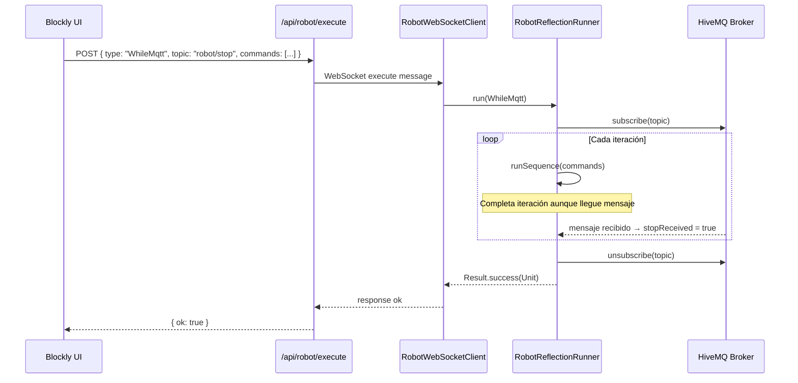
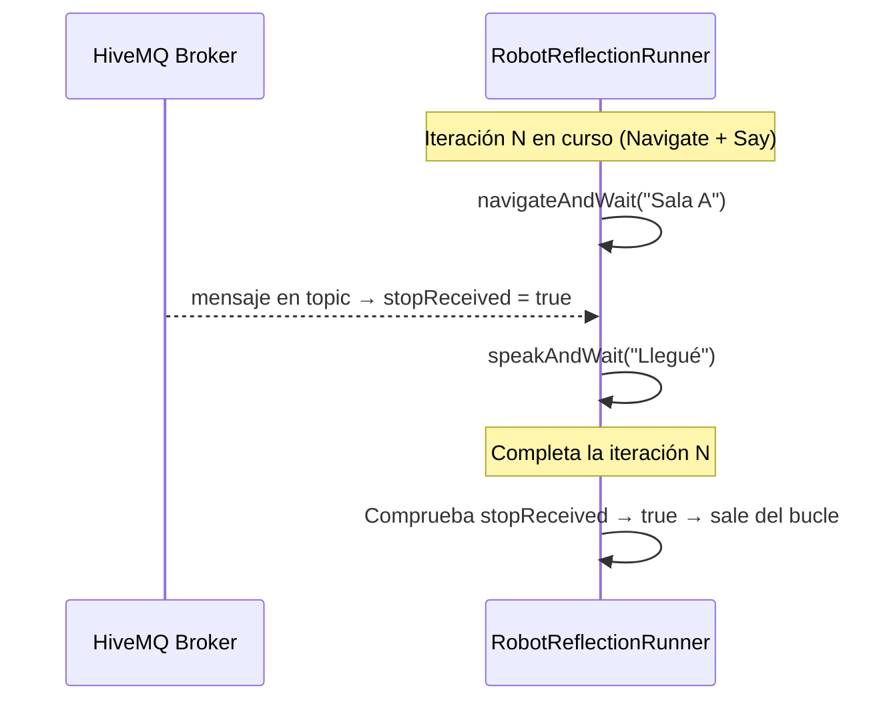

# Documento de Diseño: WhileMQTT Block

## Visión General

El bloque `WhileMQTT` permite al robot ejecutar en bucle infinito una secuencia de comandos hijos (Navigate, Say, etc.) y detenerse únicamente cuando llega un mensaje a un topic MQTT específico. Al recibir el mensaje de parada, el robot completa la iteración en curso antes de salir del bucle y continúa con el siguiente bloque de la secuencia.

La plataforma ya dispone de credenciales HiveMQ configuradas. El patrón de implementación sigue exactamente el mismo modelo que `WhileListen`: una variable `@Volatile` actualizada por un listener externo (en este caso, un cliente MQTT en lugar del SDK de ASR de Temi).

---

## Arquitectura

```mermaid
graph TD
    A[Blockly UI<br/>temi_while_mqtt] -->|workspace JSON| B[extractCommandsFromWorkspace]
    B -->|WhileMqttCommand| C[POST /api/robot/execute]
    C -->|WebSocket| D[RobotWebSocketClient]
    D -->|parseCommand| E[RobotCommand.WhileMqtt]
    E --> F[RobotReflectionRunner.run]
    F -->|suscribe topic| G[HiveMQ Broker]
    G -->|mensaje llegó| H[@Volatile stopReceived = true]
    H -->|fin de iteración| F
    F -->|continúa| I[Siguiente bloque]
```

---

## Diagramas de Secuencia

### Flujo de ejecución normal



### Flujo de parada a mitad de iteración



---

## Componentes e Interfaces

### 1. Bloque Blockly (`temi_while_mqtt`)

**Propósito**: Elemento visual en el toolbox de Control que permite al usuario configurar el topic MQTT de parada.

**Definición JSON**:
```typescript
{
  type: "temi_while_mqtt",
  message0: "repetir hasta mensaje MQTT en topic %1",
  args0: [{ type: "field_input", name: "TOPIC", text: "robot/stop" }],
  message1: "%1",
  args1: [{ type: "input_statement", name: "DO" }],
  previousStatement: null,
  nextStatement: null,
  colour: 120,
  tooltip: "Repite los bloques internos hasta recibir un mensaje en el topic MQTT indicado"
}
```

**Responsabilidades**:
- Exponer el campo `TOPIC` (texto libre, default `"robot/stop"`)
- Contener bloques hijos en el input `DO`
- Integrarse en la categoría "Control" del toolbox

---

### 2. Tipo TypeScript (`WhileMqttCommand`)

**Archivo**: `src/lib/robot-adapter.ts`

```typescript
export type WhileMqttCommand = {
  type: "WhileMqtt";
  topic: string;
  commands: RobotExecuteCommand[];
};
```

`WhileMqttCommand` se añade a la unión `RobotExecuteCommand`.

**Extracción en `extractCommandsFromWorkspace`**:
```typescript
} else if (b["type"] === "temi_while_mqtt") {
  const topic = (fields?.["TOPIC"] ?? "robot/stop").trim();
  const doInput = (b["inputs"] as Record<string, unknown>)?.["DO"];
  const innerBlock = (doInput as Record<string, unknown>)?.["block"];
  const innerCommands: RobotExecuteCommand[] = [];
  walk(innerBlock, innerCommands);
  acc.push({ type: "WhileMqtt", topic, commands: innerCommands });
}
```

---

### 3. Comando Android (`RobotCommand.WhileMqtt`)

**Archivo**: `RobotCommandRunner.kt`

```kotlin
data class WhileMqtt(
    val topic: String,
    val commands: List<RobotCommand>
) : RobotCommand()
```

---

### 4. Parser WebSocket (`RobotWebSocketClient.kt`)

Nuevo caso en `parseCommand`:
```kotlin
"whileMqtt", "WhileMqtt" -> RobotCommand.WhileMqtt(
    topic = obj.get("topic").asString,
    commands = parseCommands(obj.getAsJsonArray("commands"))
)
```

---

### 5. Ejecutor (`RobotReflectionRunner.kt`)

**Patrón**: idéntico a `WhileListen` — variable `@Volatile` actualizada por callback externo.

```kotlin
is RobotCommand.WhileMqtt -> whileMqttAndWait(command.topic, command.commands)
```

```kotlin
private fun whileMqttAndWait(topic: String, commands: List<RobotCommand>): Result<Unit> {
    @Volatile var stopReceived = false

    val mqttClient = buildMqttClient()  // HiveMQ credentials from BuildConfig/constants
    mqttClient.subscribe(topic) { stopReceived = true }

    return try {
        while (true) {
            val result = runSequence(commands)
            if (result.isFailure) return result
            if (stopReceived) break
        }
        Result.success(Unit)
    } finally {
        mqttClient.unsubscribeAndDisconnect(topic)
    }
}
```

**Invariante del bucle**: `stopReceived` solo puede pasar de `false` a `true` (nunca al revés). La comprobación ocurre **después** de completar cada iteración, garantizando que ninguna iteración queda a medias.

---

## Modelos de Datos

### Mensaje JSON enviado al robot

```typescript
{
  type: "WhileMqtt",
  topic: string,          // e.g. "robot/stop"
  commands: RobotExecuteCommand[]
}
```

### Credenciales MQTT

Las credenciales HiveMQ (broker URL, puerto, usuario, contraseña) ya están disponibles en la plataforma. En la app Android se accederán como constantes en un objeto `MqttConfig` (o `BuildConfig` si ya están inyectadas):

```kotlin
object MqttConfig {
    const val BROKER_URI = "ssl://..."   // HiveMQ Cloud endpoint
    const val PORT = 8883
    const val USERNAME = "..."
    const val PASSWORD = "..."
    const val CLIENT_ID_PREFIX = "temi-robot-"
}
```

---

## Algoritmos con Especificaciones Formales

### Algoritmo principal: `whileMqttAndWait`

```pascal
ALGORITHM whileMqttAndWait(topic, commands)
INPUT:  topic    — String no vacío (topic MQTT de parada)
        commands — List<RobotCommand> (secuencia de comandos hijos)
OUTPUT: Result<Unit>

PRECONDITIONS:
  - topic ≠ ""
  - commands es una lista válida (puede estar vacía)
  - Credenciales MQTT disponibles y broker accesible

POSTCONDITIONS:
  - Si Result.success: el bucle terminó porque llegó un mensaje al topic
  - Si Result.failure: ocurrió un error en runSequence o en la conexión MQTT
  - En ambos casos: cliente MQTT desconectado y topic desuscrito

BEGIN
  stopReceived ← false                    // @Volatile

  mqttClient ← buildMqttClient()
  mqttClient.subscribe(topic, callback: stopReceived ← true)

  TRY
    LOOP INVARIANT: stopReceived puede ser true o false; si true, se sale al final de la iteración
    WHILE true DO
      result ← runSequence(commands)
      IF result.isFailure THEN
        RETURN result
      END IF
      IF stopReceived THEN
        BREAK
      END IF
    END WHILE
    RETURN Result.success(Unit)
  FINALLY
    mqttClient.unsubscribeAndDisconnect(topic)
  END TRY
END
```

**Invariante del bucle**:
- Cada iteración se ejecuta completa antes de comprobar `stopReceived`
- `stopReceived` es monotónica: `false → true`, nunca `true → false`
- El cliente MQTT siempre se desconecta en el bloque `finally`

---

### Algoritmo auxiliar: `buildMqttClient`

```pascal
ALGORITHM buildMqttClient()
OUTPUT: MqttClient conectado y listo para suscribirse

BEGIN
  clientId ← MqttConfig.CLIENT_ID_PREFIX + UUID.randomUUID()
  client   ← MqttClient(MqttConfig.BROKER_URI, clientId)
  options  ← MqttConnectOptions(
               username = MqttConfig.USERNAME,
               password = MqttConfig.PASSWORD,
               cleanSession = true
             )
  client.connect(options)
  RETURN client
END
```

---

## Manejo de Errores

### Error 1: Broker MQTT no accesible

**Condición**: `mqttClient.connect()` lanza excepción (red no disponible, credenciales incorrectas).  
**Respuesta**: `whileMqttAndWait` retorna `Result.failure(e)`.  
**Recuperación**: El `RobotWebSocketClient` envía `response { ok: false, message: "MQTT connection failed: ..." }` al servidor. La UI muestra el error al usuario.

### Error 2: Desconexión MQTT durante el bucle

**Condición**: El broker cierra la conexión mientras el bucle está activo.  
**Respuesta**: El callback de desconexión del cliente MQTT puede intentar reconectar (política configurable) o simplemente dejar `stopReceived = false`. Si no se reconecta, el bucle continúa indefinidamente hasta que `runSequence` falle.  
**Decisión de diseño**: En v1, si la conexión se pierde, el bucle continúa (no se interrumpe). Se puede añadir un timeout de seguridad en iteraciones futuras.

### Error 3: Topic vacío

**Condición**: El usuario deja el campo TOPIC vacío en Blockly.  
**Respuesta**: `extractCommandsFromWorkspace` usa `"robot/stop"` como valor por defecto.

### Error 4: `commands` vacío

**Condición**: El bloque `WhileMqtt` no tiene bloques hijos.  
**Respuesta**: El bucle se ejecuta con `runSequence([])` que retorna `Result.success(Unit)` inmediatamente. El bucle espera el mensaje MQTT sin hacer nada (comportamiento válido).

---

## Estrategia de Testing

### Tests unitarios

- `WhileMqttCommand` se serializa/deserializa correctamente a/desde JSON
- `extractCommandsFromWorkspace` extrae `WhileMqttCommand` con topic y comandos hijos correctos
- `parseCommand` en `RobotWebSocketClient` parsea `"WhileMqtt"` y `"whileMqtt"` correctamente
- `RobotReflectionRunner`: mock de `runSequence` + mock de cliente MQTT verifica que:
  - El bucle se detiene tras recibir el mensaje MQTT
  - La iteración en curso se completa antes de salir
  - El cliente MQTT siempre se desconecta (incluso en caso de error)

### Tests de propiedad (Property-Based)

**Librería**: fast-check (TypeScript) / JUnit + Kotest (Kotlin)

**Propiedad 1**: Para cualquier topic no vacío y cualquier lista de comandos, si `stopReceived` se activa durante la iteración N, el bucle ejecuta exactamente N iteraciones completas antes de salir.
**Valida: Requisitos 4.3, 4.4**

**Propiedad 2**: `extractCommandsFromWorkspace` con un bloque `temi_while_mqtt` siempre produce exactamente un `WhileMqttCommand` con el topic correcto y los comandos hijos correctos, independientemente del número de bloques hijos.
**Valida: Requisitos 2.1**

**Propiedad 3**: El cliente MQTT siempre se desconecta al finalizar `whileMqttAndWait`, tanto en el camino feliz como en el de error.
**Valida: Requisitos 5.2**

### Tests de integración

- Publicar un mensaje MQTT en el topic desde un cliente de prueba y verificar que el robot detiene el bucle al finalizar la iteración en curso.
- Verificar que bloques posteriores al `WhileMqtt` se ejecutan correctamente tras la parada.

---

## Consideraciones de Seguridad

- Las credenciales MQTT no se exponen en el JSON enviado al robot (solo se usa el `topic`). Las credenciales residen únicamente en la app Android.
- El topic es un string libre; en v1 no se valida el formato. Se puede añadir validación de formato MQTT (`a/b/c`) en iteraciones futuras.
- La conexión al broker HiveMQ Cloud usa TLS (`ssl://`), garantizando cifrado en tránsito.

---

## Dependencias

### App Android
- `org.eclipse.paho:org.eclipse.paho.client.mqttv3` (o `org.eclipse.paho:org.eclipse.paho.android.service`) — cliente MQTT para Android. Alternativa: `com.hivemq:hivemq-mqtt-client` (más moderno, soporte MQTT 5).

### Plataforma Web (Next.js)
- Sin nuevas dependencias. Solo cambios en `robot-adapter.ts` y `blockly-workspace.tsx`.

---

## Propiedades de Corrección

*Una propiedad es una característica o comportamiento que debe mantenerse verdadero en todas las ejecuciones válidas del sistema — esencialmente, una declaración formal sobre lo que el sistema debe hacer. Las propiedades sirven como puente entre las especificaciones legibles por humanos y las garantías de corrección verificables por máquinas.*

### Propiedad 1: Round-trip de serialización de WhileMqttCommand

*Para cualquier* `WhileMqttCommand` válido (con topic no vacío y lista de comandos hijos arbitraria), serializar a JSON y luego parsear con `RobotWebSocketClient` debe producir un `RobotCommand.WhileMqtt` equivalente al original.

**Valida: Requisitos 3.3**

---

### Propiedad 2: Extracción correcta del workspace

*Para cualquier* workspace Blockly que contenga un bloque `temi_while_mqtt` con un topic arbitrario y una lista arbitraria de bloques hijos, `extractCommandsFromWorkspace` debe producir exactamente un `WhileMqttCommand` con el topic correcto y los comandos hijos correctos.

**Valida: Requisitos 2.1**

---

### Propiedad 3: Completitud de iteración ante mensaje MQTT

*Para cualquier* lista de comandos hijos y cualquier momento en que `stopReceived` se active durante la iteración N, `whileMqttAndWait` debe ejecutar exactamente N iteraciones completas antes de salir del bucle.

**Valida: Requisitos 4.3, 4.4**

---

### Propiedad 4: Limpieza garantizada del cliente MQTT

*Para cualquier* ejecución de `whileMqttAndWait` (exitosa o fallida, con cualquier topic y cualquier lista de comandos), el cliente MQTT debe desconectarse y desuscribirse del topic al finalizar.

**Valida: Requisitos 5.2**

---

### Propiedad 5: Monotonía de stopReceived

*Para cualquier* ejecución del bucle `whileMqttAndWait`, la variable `stopReceived` es monotónica: una vez que toma el valor `true`, no puede volver a `false` en ninguna iteración posterior.

**Valida: Requisitos 4.6**

---

### Propiedad 6: Continuación de la secuencia tras el bucle

*Para cualquier* secuencia de comandos que contenga un `WhileMqtt` seguido de otros comandos, tras la finalización del bucle (por recepción del mensaje MQTT), todos los comandos posteriores deben ejecutarse correctamente.

**Valida: Requisitos 4.5**
